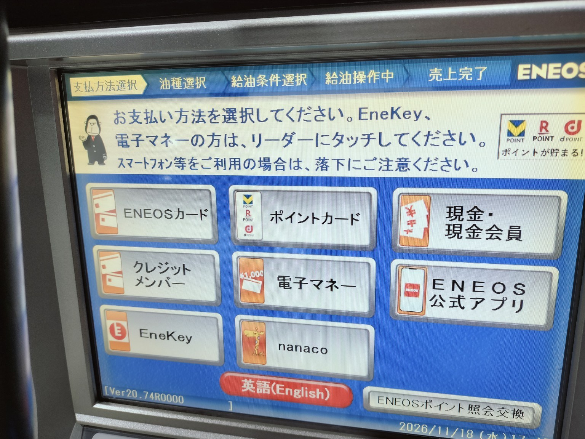

# マイコン実習 第 26 回

## 問題文から制御を設計する ― 終了要求と非常停止

**要求を覚えておく。優先順位を決める。**

2026年11月30日

---

## 今日の位置づけ

第 25 回では、コンベヤを **状態（`state`）** で整理し、状態ブロック内で長い `sleep` を使わずに、約 100 msごとのループで待機時間や点滅を扱う方法を考えました。

今日も、**第 25 回までに自分が書いたプログラムを改良** します。新しいプログラムを白紙から作らなくてよいです。

### 今日の目標

1. **技能検定 3 級相当の自動モードを完成させる。**  
PB3 の長押しによる終了要求と PL1 の点滅を仕様どおりにする。
3. **非常停止を追加する。**  
PB5 を全状態に優先させ、非常停止状態での仕事と解除条件を設計する。
4. 余裕がある人は、以前作った手動モードとの統合に進む。

| 到達段階 | 目指すこと |
|---|---|
| 基本 | PB3 の終了要求を含む自動モードを完成させ、実機で確認する |
| 標準 | PB5 の非常停止を追加し、優先順位と解除後の動作を確認する |
| 発展 | SS0 による手動／自動の統合に進む。余裕があれば時間計測の改善を検討する |

**未完成でも、問題文から読み取った条件・途中のコード・実機で確認できたことを残します。**

> 今日の中心は、仕様から状態と条件を設計できるようになることを優先します。

---

# 1. イントロ　身近な設備にも「状態」がある ― 給油機を観察する

<center>
    
</center>
<center>
    
</center>

2枚目の画面上部に、次の流れが表示されています。

```text
支払方法選択 → 油種選択 → 給油条件選択 → 給油操作中 → 売上完了
```

**画面は、今どの状態にいるかを利用者にも示している** わけです。

では、最初の「ようこそ」画面は、何もしていないのでしょうか。

- 画面を表示する。
- 利用者が画面に触れるのを待つ。
- 機種や設定によっては、待機中に案内や広告を表示する。

**待機状態にも仕事があります。** コンベヤの `OFF` も同じです。モータを停止し、起動条件が成立するのを待つという仕事をしています。

> 観察の問い：その状態では **何をするか／どの入力を受け付けるか／何が起きたら次へ進むか**。

※ この写真から分かるのは、画面に表示された操作の流れです。給油機内部の安全回路や細かな状態まで、この写真だけで決めつけることはできません。

---

# 2. 第 25 回の「4 つの問い」を思い出す

状態を一つ決めたら、次を考えます。

| 順番 | 問い | コンベヤでの例 |
|---|---|---|
| 1 | 今の状態は？ | `WAIT_LEFT` |
| 2 | その状態で何をする？ | コンベヤを停止し、時間を数える |
| 3 | 何が起きたらその状態を終える？ | 約 1 秒経過したら |
| 4 | 次の状態は？ | `MOVE_RIGHT` |

第 26 回でも、新しい仕組みを暗記するのではなく、**問題文からこの4 つを考えます。**

### 仕様の読み落としチェック：自動サイクルの起動条件

> パレットがコンベヤ右端にあるとき [PB1] を押すと、

**問：** [PB1] を押しさえすれば、どの位置からでも自動サイクルを始められますか。自分の `OFF` 状態のコードを、問題文と照らし合わせてください。

ただし、問題文には状態ごとの仕事だけでなく、**「どの状態で有効な条件か」「どの条件を優先するか」** も書かれています.

---

# 3. PB3 - 問題文の「サイクル動作中に」を読む

3級の自動モードには、次の指定があります。

> 「サイクル動作」中に [PB3] を２秒以上押すと、[PL1] が点灯から点滅に切り替わり、4 の動作終了後に「サイクル動作」を終了する。

同じ問題文で **1～4の一連の動作を「サイクル動作」** と定義しています。

1. 左行して左端に到着したら停止する。
2. 左端で約 1 秒間停止する。
3. 右行して右端に到着したら停止する。
4. 右端で約 3 秒間停止する。

### 問いA：PB3 を調べてよいのは、どの状態か？

| 自分たちの状態名の例 | サイクル動作中か（○／×） | PB3 による自動終了要求を受け付けるか（○／×） |
|---|---|---|
| `OFF` | | |
| `MOVE_LEFT` | | |
| `WAIT_LEFT` | | |
| `MOVE_RIGHT` | | |
| `WAIT_RIGHT` | | |

**考えるヒント：コンベヤが止まっていることと、サイクル動作が終わっていることは同じでしょうか。** 左端・右端の待機状態も含め、問題文の 1～4 と照らし合わせて判断しましょう。  
また、手動モードでは PB3 に別の役割（左行）があります。**同じボタンでも、モードや状態によって動作が違います。**

### 問いB：Python ではどう表すか？

「PB3 が押されている」だけでは条件が足りません。

```python
if PB3.value() == 1:
    # これだけでは「サイクル動作中に」が表現されていない
    ...
```

まず、**自分のプログラムのどの状態がサイクル動作中なのか** を特定してください。その条件を Python で表現してから、PB3 の長押しを判定します。

`if`、`elif`、`and`、`or` など既に習った書き方で表現できます。そして条件の表し方は何通りもあります。
---

# 4. PB3 ― 「押された」と「要求を記憶する」

PB3 を約 2 秒押しても、その場ではコンベヤを止めません。

```text
サイクル動作中に PB3 を約 2 秒押し続ける
           ↓
終了要求が成立したことを記憶する
           ↓
PL1 を点滅させる／現在のサイクルは続ける
           ↓
右端の約 3 秒待機を終える
           ↓
記憶していた要求を調べ、自動サイクルを終了する
```

ここで設計するのは、次の4点です。

| 設計すること | 考える問い |
|---|---|
| 記憶すること | 後で何が分かればよい？ |
| 記憶する瞬間 | どんな条件が成立したときに覚えておく？ |
| 記憶を使う場所 | どの状態の終了時に調べる？ |
| 記憶を消す（忘れる）瞬間 | いつ初期化しないと次の運転に影響する？ |

区別したい情報が「終了要求あり／なし」の2通りなら、その 2 通りを表現できればよいです。

```python
# 表し方の一例。これは Python が決めた名前ではありません。
teishi = "しない"

# 終了要求を受け付けたとき
teishi = "する"

# あとで要求を確かめるとき
if teishi == "する":
    ...
```

`finish_flag = True / False` でも、`finish = 1 / 0` でも構いません。**どんな値とどんな変数名にするかは自由です。でもそこにセンスが問われます。そして使い方を一貫させる**ことが重要です。何となく変数を増やすのではなく、何を覚えたいのかを先に決めてください。

### 長押し判定も、時間の扱いは既習内容

第 25 回と同じ約 100 ms のループなら、20 回で約 2 秒です。

- 押している間だけ数える。
- 途中で離したら、連続押下のカウントをやり直す。
- **サイクル動作でない間の押下時間を持ち越さない。**
- 終了要求を受け付けたら、PB3 を離しても要求は残る。

長押しを測るカウンタと、**終了要求が成立したことを覚える情報** は、役割が違います。

---

# 5. 緊急停止 PB5 ― 「全ての状態の時に」を読む

非常停止について、問題文にこう書かれています。

> 非常停止は、他の全ての操作に優先するものである。
>
> 全ての状態の時に、非常停止ボタン [PB5] を押した場合、非常停止が働いた状態となり、動作中のコンベヤは即時に停止させ、「サイクル動作」は終了する。

PB3 では「サイクル動作中に」でした。PB5 は **「全ての状態の時に」** です。

ここから読み取れるのは、**通常の各 `if state == ...` に入る前に、状態とは無関係に PB5 を確認する設計ができる** ということです。

```text
while True:
    ├─ まず、全状態に優先する PB5 を確認する
    │
    ├─ 現在の状態に応じた処理を一つ行う
    │     EMERGENCY_STOP / OFF / MOVE_LEFT / ...
    │
    └─ sleep_ms(100)
```

PB5 を確認した同じループで、**後続の通常運転処理がモータを再び ON にしない構造** が必要です。

これは「状態で考える」という第 25 回の原則に反しません。  
**どの状態でも有効な条件は、状態ごとの条件より上位に置く** という設計です。

---

# 6. 非常停止になったら、あとはいつもの状態設計

問題文にある非常停止状態の仕事は、次のとおりです。

- コンベヤを停止し、自動サイクルを終了する。
- 非常停止中は PL4 を点灯する。
- 非常停止中は PB1 / PB2 / PB3 で起動させない。
- PB4 の操作で非常停止を解除し、PL4 を消灯する。

第 25 回の4 つの問いに戻ります。

| 問い | 非常停止では？ |
|---|---|
| 今の状態は？ | 例えば `EMERGENCY_STOP` |
| その状態で何をする？ | RY1 と RY2 を OFF、PL1 を OFF、PL4 を ON。通常起動は受け付けない |
| 何が起きたらその状態を終える？ | 非常停止ボタンが解除され、PB4 でリセット操作されたとき |
| 次の状態は？ | 自動的に走り出さない **停止・起動待ち** の状態（例：`OFF`） |

**「PB5 を検出する場所」と「非常停止状態の仕事」は、別の設計項目です。**

また、PB5 を押したまま PB4 を押しても、PB5 を優先します。解除後は PB1 等による新しい起動操作が必要です。

> 非常停止を解除したからといって、非常停止前の `MOVE_LEFT` や `MOVE_RIGHT` に戻してはいけません。終了要求やカウンタも、次の運転を妨げないよう整理します。

---

# 7. 「即時」と書かれている。今のプログラムは何 ms で止まる？

第 25 回までのプログラムでは、`while True` の最後に `time.sleep_ms(100)` が一度だけあります。

```text
PB5 を調べる                       PB5 を調べる
    ↑                                 ↑
    ├─ ループ内の処理 ─ sleep(100 ms) ─┤
          ↑
        ここで PB5 を押したら？
```

PB5 を調べ終わった直後に押された場合、**次の判定まで約 100 ms 待つ可能性** があります。

厳密には、ループ内の処理時間や停止出力の切替時間も加わるため、**最大 100 ms を保証できるわけではありません。**

ただし、次のことは説明できるはずです。

- PB5 はいつ調べられているか。
- なぜ押した瞬間とは限らないか。
- どのタイミングで押すと反応が遅くなるか。

大事なことは、**停止の時間的な挙動を自分のコードから説明できること。** 

※ ここで扱うのは学習用試験盤のソフトウェアによる非常停止の模擬です。実設備の人身安全をこのソフトウェアだけで保証するものではありません。

---

# 8. 実装の進め方

必ず **少し変更 → 個別確認 → 統合 → 実機検証** の順に進めます。

1. 第 25 回の最新版をコピーして、第 26 回用のファイルを作る。
2. PB3 の条件を **問題文から** 整理する。「サイクル動作中」を Python で表す。
3. 長押し判定 → 終了要求の記憶 → PL1 点滅 → 右端 3 秒後の終了を、順に確認する。
4. PB5 を全状態から受け付ける場所を決める。
5. 非常停止状態の仕事・解除条件・遷移先を決め、実装する。
6. 左行中・右行中・待機中・停止中で、PB5 を実機確認する。
7. 先へ進める人は手動モードとの統合を考える。

手動モードを統合する場合、PB3 は手動では左行、自動サイクル中では終了要求です。**SS0 の入力配線と判定値は実機で確認してから** 組み込みましょう。

---

# まとめ

- **問題文の限定条件を見落とさない。** 「サイクル動作中に」と「全ての状態の時に」は、プログラム上の配置を変える。
- **覚える内容は自分で設計する。** `finish_flag` や `True` が唯一の正解ではない。
- **非常停止も一つの状態。** その状態の仕事・終了条件・次の状態を決める。
- **応答するまでの時間を説明する。** 100 msのループには約 100 ms に近い判定待ちが生じ得る。

**3級も2級も、まずは「仕様を読む → 状態・条件・記憶する情報を決める → 実装する → 確認する」です。**

授業終了時には、完成・未完成にかかわらず、改良したプログラムと確認結果を保存・提出します。  
**最後の10分は記録・提出・片付けに使います。**
