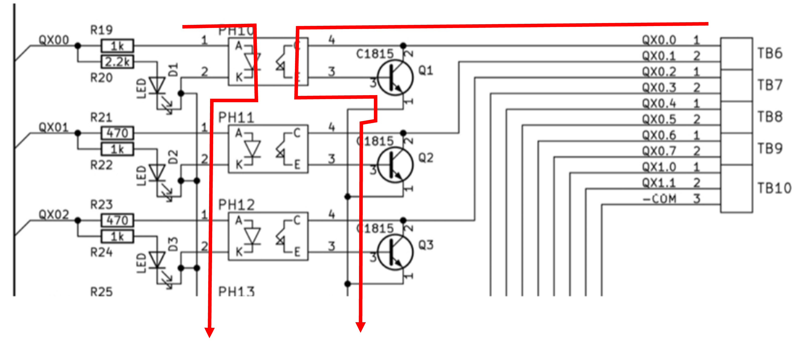
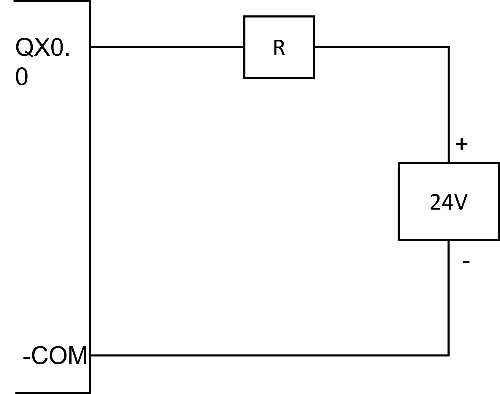

# PLC 応用編
## リレーを動かしてください

- 基盤の回路図は以下のようになっている
- QX0.0 を H にすると Q1 のベースが ON になる (ただし電源がない) 
  - 電源 (24V) を接続する
  - 電源と負荷を接続する
<center>

</center>

### 回路図
<center>


R:リレー
</center>

### プログラム
- QX0.0 は DO_4 (デジタルアウトプットの4番) につながっているので、DO_4 を　H にする

```C++
void setup() {
  pinMode(4, OUTPUT);  // GPIO 4 を出力モードに設定
  digitalWrite(4, HIGH); // GPIO 4 を HIGH（3.3V）に設定
}

void loop() {
  // ループ内で特に何もしない
}
```

# ピックアンドプレースを動してみる

## I/O 表

これよりあとは、以下の入出力対応とする

| IX0.0 | 

## ２．IX1.0 の SW を押すと　QX1.0 のハンドのチャックが閉まり、離すと開くようにする


回路とプログラムを作成し、動作を確認する：

1. IX1.0 -> D_33
2. QX1.0 -> D_16
3. ハンドのチャックに使う出力端子は　QX1.0 とする
(エアコンプレッサーが一台しかないので順番にテストしてください)


```c++
void setup() {
  pinMode(33, INPUT);   // GPIO 33 (IX1.0) を入力モードに設定
  pinMode(16, OUTPUT);  // GPIO 16 (QX1.0) を出力モードに設定
}

void loop() {
  if (digitalRead(33) == HIGH) {  // GPIO 33 が HIGH のとき
    digitalWrite(16, HIGH);       // GPIO 16 を HIGH にする
  } else {
    digitalWrite(16, LOW);        // GPIO 16 を LOW にする
  }
}
```

### 質問

入力の不定状態 (0 でも 1 でもない状態) を避けるため、通常、入力側にはプルアップ抵抗もしくはプルダウン抵抗をいれる。この CQ 出版の基板回路はどのようになっているか。

# 入出力

| P&P  | PLC 基板 | ESP32 PIN |接続先  |
|:------|:------:|:------:|:------:|
| X1   | IX0.0   | 17 | フォトセンサ(右) (遮ると ON) |
| X2   | IX0.1   | 18  | フォトセンサ(左) (遮ると ON) |
| X3   | IX0.2   | 19  | リードスイッチ (下限) |
| X4   | IX0.3   | 21 |  リードスイッチ (上限) |
| CR2  | QX0.4   |  5 |  モーター (右に移動)   |
| CR1   | QX0.5  | 12 |  モーター (左に移動)  |
| SV3   | XQ0.6   | 13 | ソレノイドバルブ (下降)*   |
| SV4   | XQ0.7    |14 | ソレノイドバルブ (上昇)*  |
| SV1   | XQ1.0    |15 | チャック (閉まる)   |

* ソレノイドバルブの動作は SV3 と SV4 の信号の組み合わせで決まる (H/H, L/L は停止)


# 演習１
- 入出力表の通り、回路を作成せよ

# 演習２
- 