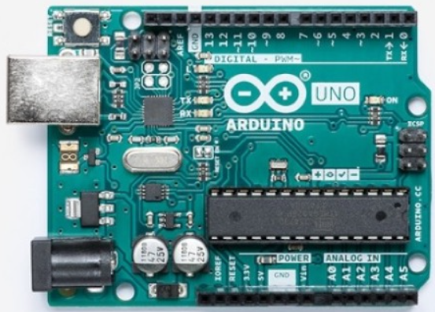

# Arduino 

Arduino も MicroBit や RaspberryPi, M5Stack シリーズとおなじく手軽な電子工作に対応したマイコンボードである。
特徴は以下のとおり：

- 歴史が古い (2005 からある) イタリア生まれ
- エンジニアでない学生でも手軽に使いやすいマイコンボード
- 開発環境に Arduino IDE という開発環境がある
- いろいろなシリーズがある
- **オープンソースハードウェア**  
回路情報が公開されていて、自由に利用していい→互換品もある
- **GPIO ピン数が多い**
- 8 ビットマイコン (そんなに高機能ではない)
- プログラミングには C 言語をつかう
  
  
Arduino UNO 外観

# Arduino IDE
- Arudino の標準開発環境
- C 言語をコンパイルして Arduino に書き込む
- 比較的新しい 2.1 系列と一世代前の 1.8 がある
  